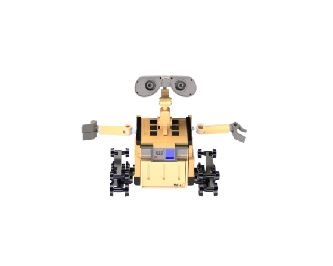
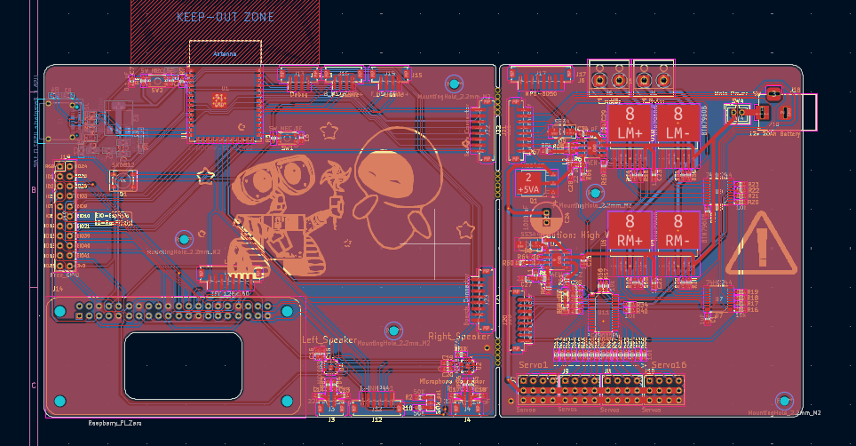
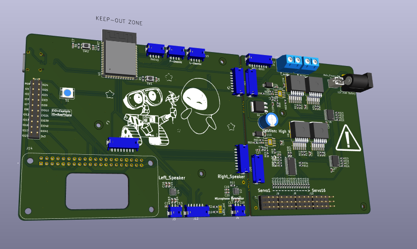
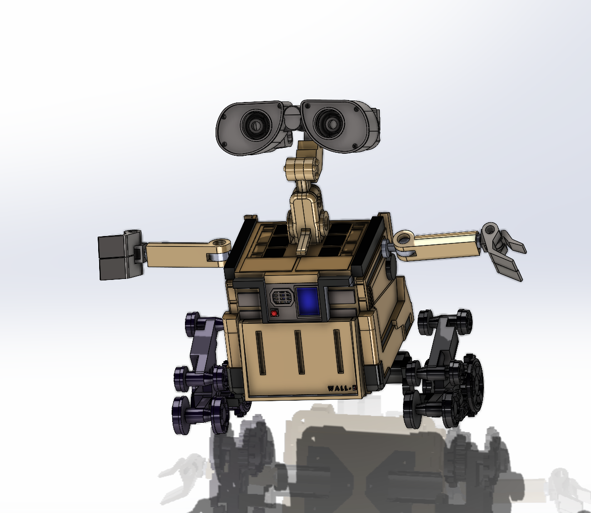
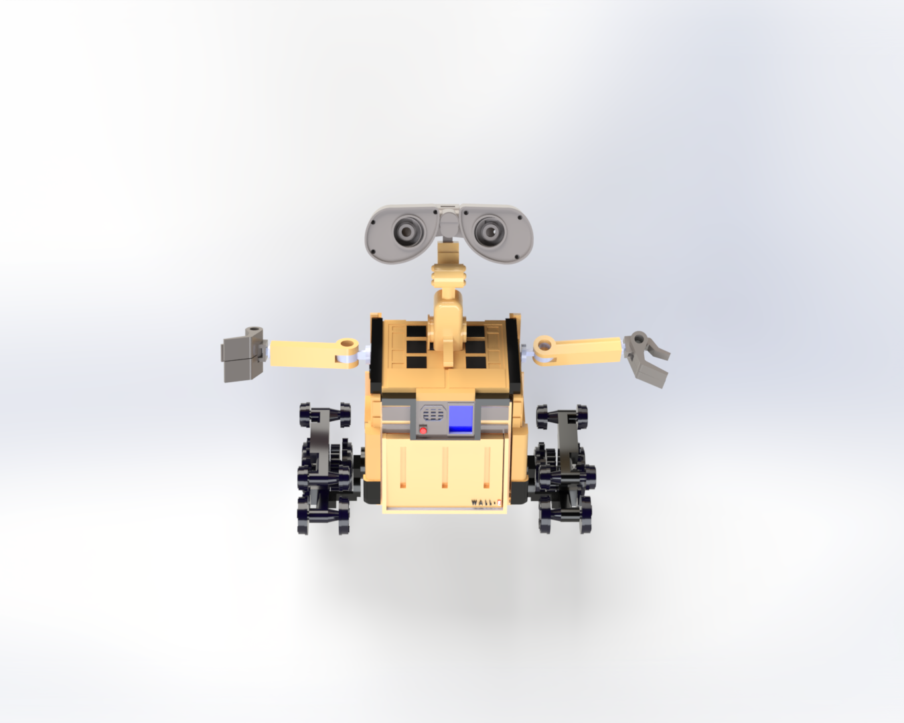

# WALL-E
-----------------------

  

----------------

## Description
A Full size Wall-E Clone from the movie WALL-E. With a ROS2+Gazebo Simulation. With Full CAD designs. 

## Featrues:
1. It will have a Simulation made with Gazebo.
2. Emulating the full motion of the real WALL-E.
3. Full PCB & 3D CAD designs.
4. Real Wall-E size.

### In V2:
- Autonomous motion
    - Adabting the Simulation using ROS2 Sensors
- Voice commanding & Sound system

## Photos:

### PCB:

### Schematic (See the [PDF](PCB/Schematic.pdf))
### 3D: 

### Simulation Demo:

## How to Build:

### 3D CAD:
1. Clone the Repo.
2. In the SW(Pack&Go) Directory, take the Wall-E.zip file and unzip it.
3. Open the main assembly in SolidWorks.
4. Edit whatever you want.
5. You can from there export to any format.
6. Enjoy.

### PCB:
1. Clone the Repo.
2. Open the PCB folder in Kicad.
3. Edit whateve you want.
4. That's it, Enjoy.

### Simulation:
1. Clone the Wall-E_Simulation Repo (You will find a shortcut in the GZ_simulation folder)
2. Make sure you have ROS2 Lyrical (Or any ROS2 Distro I believe) & Gazebo_Sim not Classic, installed on your linux machine.
3. Copy the package folder to your ROS2 Workspace.
4. Run `colcon build` and don't forget to source your workspace
5. Edit whatever you want.
6. Run `colcon build` again.
7. Run `ros2 launch wall-e_full gz_simulator_launch.py`
8. That's it, you will see gazebo launching and with your new changes.
9. Enjoyyy ❤️

# Build with ❤️ by @Nadoooor & @ZIZO932

